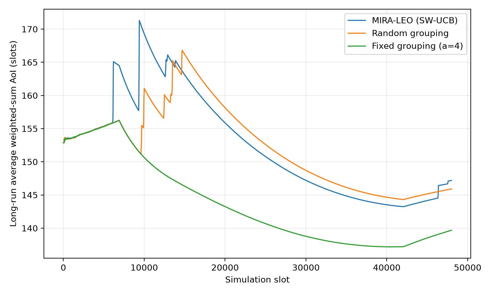

# MIRA-LEO 論文程式與模擬結果

目前使用的程式位於 [`mira_leo_study/`](mira_leo_study/README.md)。Repository 根目錄與 `mira_leo_v1/`、`mira_leo_v2/`、`mira_leo_v2a3_verified/` 中的較早版本保留供歷史參考。

## 目前版本

- Edge threshold：20 度；edge penalty：B=0.05。
- 分組 actions：`[1, 2, 4, 5, 8, 10]`；Fixed baseline：`a=4`。
- Physical slot：10 ms；每 1 秒重新分組；SW-UCB window：10 秒 / 10 epochs。
- 使用 strict Algorithm 2、TWC/AIM staircase power allocation 與 global-SIC power repair。
- 功率最佳化明確無解時，該衛星當下 slot 不傳輸，排程中的更新計為失敗；失敗仍計入 AoI 與 reward。

實作與限制詳見 [`mira_leo_study/README.md`](mira_leo_study/README.md)。

## 已保存的完整結果

結果根目錄：[`outputs/fixed_phi20_B005_rg1s_compact_outage/`](outputs/fixed_phi20_B005_rg1s_compact_outage/)。

本次完整執行為 **48,000 slots / 480 秒 / seed=0**，包含三種策略的逐 slot CSV、Parquet、設定快照、reward-bounds pilot、圖表與診斷資料。1,000-slot 測試結果另外保存在 [`debug/slots_1000_seed_0/`](outputs/fixed_phi20_B005_rg1s_compact_outage/debug/slots_1000_seed_0/)。

| 策略 | 全程平均加權 AoI（slots） | 功率失敗 slots | 狀態 |
|---|---:|---:|---|
| MIRA-LEO / SW-UCB | 147.181098 | 615 | `REWARD_RANGE_MISMATCH` |
| Random grouping | 145.911985 | 559 | `COMPLETED_WITH_POWER_OUTAGES` |
| Fixed grouping / a=4 | 139.680370 | 0 | `COMPLETED` |

AoI 為 constellation 的 weighted-sum AoI，數值較低較好；cumulative average 包含全程探索與失敗。這次 SW-UCB 的 reward clipping 觸發範圍失配標記，以上數值保留原始執行結果，尚不能作為已通過 reward-range 檢查的最終比較。

- [完整執行報告](outputs/fixed_phi20_B005_rg1s_compact_outage/report.md)
- [三方法比較摘要](outputs/fixed_phi20_B005_rg1s_compact_outage/formal_results/convergence_long_run_aoi/comparison_summary.csv)
- [逐 slot 資料與圖表](outputs/fixed_phi20_B005_rg1s_compact_outage/formal_results/convergence_long_run_aoi/)
- [Regrouping overhead](outputs/fixed_phi20_B005_rg1s_compact_outage/formal_results/regrouping_overhead/)
- [SW-UCB / AoI 失敗尖峰診斷](outputs/fixed_phi20_B005_rg1s_compact_outage/diagnostics/aoi_bandit_analysis/diagnosis.md)
- [快照檔案 SHA-256](SNAPSHOT_MANIFEST.json)



## Windows PowerShell 安裝與驗證

從 repository 根目錄執行，使用 Python 3.11 以上：

```powershell
py -3 -m venv .venv
.\.venv\Scripts\python.exe -m pip install -r .\mira_leo_study\requirements.txt
.\.venv\Scripts\python.exe -m compileall -q .\mira_leo_study
.\.venv\Scripts\python.exe -m mira_leo_study validate-config
```

以上檢查不執行模擬。套件依賴以 [`requirements.txt`](mira_leo_study/requirements.txt) 為準；虛擬環境與 Python cache 不納入本次快照。

## 自行執行新的模擬

1,000-slot 測試：

```powershell
.\.venv\Scripts\python.exe -m mira_leo_study paper-results --slots 1000 --seed 0 --outputs .\outputs\new_run
```

完整 48,000-slot 三方法執行：

```powershell
.\.venv\Scripts\python.exe -m mira_leo_study paper-results --seed 0 --outputs .\outputs\new_run
```

缺少相符的 reward bounds 時會先自動執行 pilot；`--slots` 只縮短正式評估，不縮短 pilot。使用新的 output 目錄可保留這次已保存的結果。
