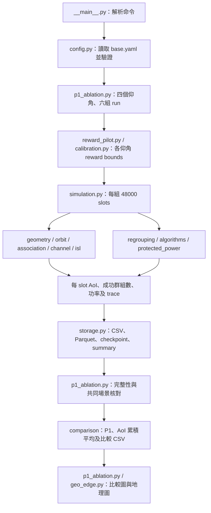

# MIRA-LEO ZIP 版程式與元件完整導讀

這份文件說明 `mira_leo_study.zip` 裡的程式如何產生場景、通道、分組、功率、AoI、CSV 和圖片，供接手程式的學長閱讀。

**本文件以使用者提供的 ZIP 逐檔核對，範圍是 φ15 主設定、固定 sat_03 ingress 的六組實驗版。不是後來修改的 φ20／random ingress／21 組版本。** 文件所列程式連結固定指向與 ZIP 一致的 Git commit，避免點到日後改寫的程式。

## 閱讀索引

- [1. 文件版本與適用範圍](#scope)
- [2. 要執行或修改功能，先找哪支程式](#navigation)
- [3. 整體資料流程及單一時槽流程](#flow)
- [4. 37 個套件程式逐一說明](#modules)
- [5. 指標、單位與演算法元件](#metrics)
- [6. 設定檔、環境與資料夾](#environment)
- [7. 輸出資料與附圖來源](#outputs)
- [8. 17 個測試檔及歷史文件](#tests)
- [9. 安裝、重跑與續跑](#commands)
- [10. 接手時容易誤解的地方](#pitfalls)

<a id="scope"></a>
## 1. 文件版本與適用範圍

| 項目 | 本文件核對的內容 |
|---|---|
| 原始檔案 | `mira_leo_study.zip`，94,877,469 bytes |
| ZIP SHA-256 | `64af72182bdda6e3ca033c5475f70a12bec1918774b54dd38c9dff8a9512582b` |
| ZIP 內套件 | `mira_leo_study/` |
| 主實驗入口 | `python -m mira_leo_study p1-ablation` |
| 主仰角門檻 | `algorithm.phi_theta_deg=15.0` |
| 資料進入衛星 | 固定 `delay.ingress_satellite="sat_03"` |
| 實驗數量 | 六組：四組 MIRA，加上 φ15 Random 與 Fixed |
| 正式功率模式 | `csi_expanded_protected_pool`，70/30，無 bottom20 fallback |
| Checkpoint schema | `7` |
| 本文件日期 | 2026-11-13，Asia/Taipei |

對應程式快照為 [Git commit 55c8d0a](https://github.com/lzz2101/code/tree/55c8d0a5e1de37b8ffcc88677148535a31163915/mira_leo_study)。已核對該 commit 的 **54 個 Python 檔、2 個設定檔及 requirements.txt，共 57 檔**，內容與 ZIP 完全相同。ZIP 的結果 provenance 另外保存 37 個來源雜湊，亦全部核對相符。

機器可讀的來源索引見 [mira_leo_zip_source_manifest.json](mira_leo_zip_source_manifest.json)。它記錄 ZIP 身分、逐檔 SHA-256、程式定義與 ZIP 中的檔案清單；不是模擬結果。

本文所有 `outputs/...` 路徑若未另說明，均指 **ZIP 裡**的路徑；GitHub 不一定包含 ZIP 的全部數據。請勿拿 repository 中其他年代的 `outputs/` 或 `results/` 當成本 ZIP 的實驗資料。

### 本版固定設定

| 類別 | 內容 |
|---|---|
| 衛星 | 8 顆、800 km、兩軌道面 5+3；合成圓軌道模型 |
| 地面範圍 | 1000×1000 km 的投影正方形 |
| UE／訂閱 | 120 個靜止 UE；3 messages，每個 message 40 個 UE，彼此不重疊 |
| 共同服務星 | 每個時槽所有 UE 共用一顆服務衛星 |
| 覆蓋門檻 | `phi_min_deg=10°` |
| 地理 edge 門檻 | 主設定 15°；MIRA 消融比較 13/15/20/25° |
| 時間 | 480 s、每 slot 0.01 s，共 48,000 slots；報表 warmup 10 s |
| Regrouping | 每 1 s／100 slots 決策並重建分組 |
| 動作 a | `[1,2,4,5,8,10]`；每個 message 分成 a 組，因此共 3a 組 |
| SW-UCB | 10 s／10 epochs window；xi=1/√2 |
| 頻率／頻寬 | 20 GHz／50 MHz；SCS 60 kHz |
| SR 通道 | b0=0.126、Omega=0.835、m=10.1；未做 SR 平均功率正規化 |
| 干擾 | 可見的非服務星持續以正規化功率 1.0 發射，採 expected cross-link power |
| 權重／門檻 | message weights=[0.7,0.2,0.1]；R_theta=1e-5 bps/Hz |
| 功率／reward | P_sat=1、V_phi=0.0005、B=0.05 |
| 換星／ISL | handover=25 ms、paper_additive；ISL 每 hop 固定 5 ms，最長鏈路 4000 km |
| Seeds | layout=42、subscription=1042、channel=0、policy=0 |

這些數據是程式合成的研究情境，不是外部量測資料。星座不是即時 TLE，也沒有從網路抓取真實衛星軌道；UE 不是匯入的實測位置。

<a id="navigation"></a>
## 2. 要執行或修改功能，先找哪支程式

| 想知道或處理什麼 | 先讀哪裡 |
|---|---|
| PowerShell 命令如何分派 | `__main__.py` |
| 六組實驗怎麼安排、讀資料、畫附圖 | `p1_ablation.py` |
| 原始 data 每個 slot 怎麼算 | `simulation.py` |
| UE 座標及投影 | `geometry.py` |
| 衛星位置隨時間變化 | `orbit.py` |
| 120 UE 怎麼分配給三個訊息 | `scenario.py` |
| 選服務星與 handover | `association.py` |
| CSI／通道衰落／外部干擾 | `channel.py` |
| 固定 ingress 到服務星的路由 | `isl.py` |
| 分組、排程、SW-UCB、解碼、AoI 公式 | `algorithms.py` |
| 每秒更新分組、slot 內保持成員 | `regrouping.py` |
| 70/30 保護池、CSI promotion、LP | `protected_power.py` |
| reward bounds 的固定校準 | `reward_pilot.py`＋`calibration.py` |
| P1 和 bandit reward 為何不同 | `p1_metrics.py`＋`algorithms.raw_reward()` |
| 16 分鐘 CSI 圖 | 三支 `csi_elevation_*.py` |
| 為何某個 group 失敗 | `diagnostic_trace.py`＋`diagnostics.py` |
| CSV／Parquet／checkpoint | `storage.py` |
| 設定來源、參數檢查、錯誤種類 | `sources.py`、`config.py`、`errors.py` |

<a id="flow"></a>
## 3. 整體資料流程及單一時槽流程

### 3.1 從命令到論文圖片



輸出順序是先算環境與更新結果，再寫 data，再彙整畫圖。不是先決定曲線形狀，也不是把圖上的值反推成模擬數據。

### 3.2 一個 physical slot 的計算順序

1. 由 `slot×0.01 s` 取得衛星 ECI／ECEF 位置，算 8×120 的距離與仰角。
2. `AssociationTracker` 依覆蓋、最低仰角、hysteresis 和 TTT 決定共同服務星，記錄 handover。
3. 更新 ISL graph／route cache，求固定 sat_03 到當下服務星的路徑與 delay。
4. 用 channel seed、slot 產生 8×120 的 indexed CSI；相同環境下不因 policy 呼叫次序而改變。
5. 若是每 100 slots 的邊界，選 action 並按當下 CSI 重建 membership；否則保持原 membership。每 slot 仍重算群組 gain、仰角與 edge flag。
6. Algorithm 2 算 AoI 改善優先權並排程：地理 edge 優先，non-edge 只選正優先權者，套用 cap。
7. 只對已排程群組分類功率池並分配功率。LP／constraints 不可行就零傳輸，保持排程集合。
8. 計算非服務星對每個 UE 的 expected interference，再取群組最差 UE 的總干擾。
9. 依 global CSI order 算速率與 SIC；另外套用 coverage、route、handover delivery gates。
10. 成功 UE reset AoI；失敗 UE 累加 AoI。從更新後的 AoI 計算 Δ、P1 與 bandit reward。
11. 每個 slot 寫入 metrics；MIRA 每 epoch 彙整一次 reward 更新原 action owner。資料按 chunk 寫檔，必要時 checkpoint。

<a id="modules"></a>
## 4. 37 個套件程式逐一說明

下列程式連結一律指向已與 ZIP 核對的固定 commit。`tests/` 另於第8節逐一列出。

### A. 命令、設定與實驗入口

#### `__init__.py`

來源：[__init__.py](https://github.com/lzz2101/code/blob/55c8d0a5e1de37b8ffcc88677148535a31163915/mira_leo_study/__init__.py)。

- **工作**：將資料夾宣告為 Python package，提供 `StudyConfig`、`load_config` 與版本字串。
- **輸入／輸出**：供其他程式 `import mira_leo_study`；本身不建立場景、不產生 data。
- **閱讀重點**：這裡的 `__version__="1.0.0"` 不是足以區分所有研究版本的唯一身分，還要看 source hash／config_id。

#### `__main__.py`

來源：[__main__.py](https://github.com/lzz2101/code/blob/55c8d0a5e1de37b8ffcc88677148535a31163915/mira_leo_study/__main__.py)；主要函式 `build_parser()`、`main()`。

- **工作**：處理 `python -m mira_leo_study ...`，讀取設定，再派送至指定功能。
- **輸入**：command、`--config`、`--outputs`、seed、resume 等命令列參數。
- **輸出**：呼叫對應工作流程，將結果摘要印成 JSON；不是主要數學計算層。
- **八個入口**：`validate-config`、`p1-ablation`、`geometry`、`orbit-visuals`、`calibrate-reward-bounds`、`paper-results`、`diagnose-results`、`smoke`。
- **執行影響**：`validate-config` 只檢查；`diagnose-results` 只讀既有結果；`smoke` 即使很短也會真的模擬。`p1-ablation` 和校準入口可能長時間運算。

#### `config.py`

來源：[config.py](https://github.com/lzz2101/code/blob/55c8d0a5e1de37b8ffcc88677148535a31163915/mira_leo_study/config.py)；主要介面 `StudyConfig`、`load_config()`、`resolve_config()`、三種 `validate_*_config()`。

- **工作**：讀 JSON-compatible YAML，提供 dotted-path 讀取／override，計算 derived 參數並檢查模型一致性。
- **輸入**：`configs/base.yaml` 或明確指定的設定。
- **輸出**：可查詢的設定物件、`config_id`、slots／noise／capacity／delay 等 derived 值；`save_config()` 保存設定快照。
- **derived 範例**：48000 slots、regrouping=100 slots、UCB window=10 epochs、handover=2.5 slots、noise power、Algorithm-2 cap。
- **驗證分工**：fixed validator 對應 φ15 主設定；P1 ablation validator 允許 13/15/20/25；phi-study validator 供保留的歷史 search API。
- **注意**：這不是任意改參數都可直接正式執行的通用 YAML；formal validator 會拒絕偏離固定情境的設定。

#### `p1_ablation.py`

來源：[p1_ablation.py](https://github.com/lzz2101/code/blob/55c8d0a5e1de37b8ffcc88677148535a31163915/mira_leo_study/p1_ablation.py)；主要函式 `experiment_matrix()`、`run_p1_ablation()`、`read_and_validate_run()`、`_comparison_artifacts()`。

- **工作**：本 ZIP 的主要六組實驗 runner；整合校準、模擬、核對、CSV、圖片與報告。
- **六組 run_id**：`mira_phi13`、`mira_phi15`、`mira_phi20`、`mira_phi25`、`random_phi15`、`fixed_phi15`。
- **輸入**：固定情境設定、輸出位置、seed=0、debug slots、resume、是否保存 group trace。
- **執行**：四個仰角分別取得相容 bounds；Random／Fixed 共用 φ15 bounds；需要時呼叫 `run_simulation()`。
- **驗證**：檢查每個 physical slot 是否完整、P1 是否為 C−Δ、排程 cadence、功率池 equality、SIC、AoI／summary 對帳，以及六組外生環境 hashes。
- **輸出**：`runs/`、`calibration/`、`comparison/`、`figures/`、`geo_edge_phi15/`、manifest／provenance／report。
- **附圖來源**：`_comparison_artifacts()` 第198–205行，篩出 φ15 三策略，對 weighted AoI 做 `cumsum()/arange()` 再畫 Time(s) 曲線。
- **不是新版**：此檔在 ZIP 是可執行的六組 runner，不能用後來已封存的同名檔內容解釋它。

### B. 場景、衛星、UE、服務星與通道

#### `geometry.py`

來源：[geometry.py](https://github.com/lzz2101/code/blob/55c8d0a5e1de37b8ffcc88677148535a31163915/mira_leo_study/geometry.py)；主要函式 `generate_devices()`、`link_geometry()`、`aeqd_forward()`／`aeqd_inverse()`。

- **工作**：球形地球座標換算、研究中心徑向投影、AEQD 投影、固定 UE 產生、距離／仰角及 coverage grid。
- **輸入**：地球半徑、研究中心、正方形範圍、layout seed、衛星 ECEF。
- **輸出**：`DeviceTable`，包括 ID、east/north、經緯度、ECEF、layout hash；8×120 距離及仰角陣列。
- **注意**：UE 位置只在建立場景時產生，之後不移動；會變的是衛星位置與 UE 所見仰角，不是 UE 在地面走動。

#### `orbit.py`

來源：[orbit.py](https://github.com/lzz2101/code/blob/55c8d0a5e1de37b8ffcc88677148535a31163915/mira_leo_study/orbit.py)；主要類別 `SyntheticConstellation`，含 `state(time_s)`。

- **工作**：建立兩軌道面 5+3 顆合成圓軌道衛星，按時間計算 ECI 及旋轉至 ECEF。
- **輸入**：高度、傾角、RAAN／phase offsets、epoch、研究中心及 overflight 時間等設定。
- **輸出**：每一時間的衛星位置陣列與軌道元素，可供幾何、association 和 ISL 使用。
- **注意**：648 等 template 參數是星座設計背景；實際評估只有8顆。不是 SGP4／TLE 軌道預測，也不會下載軌道檔。

#### `scenario.py`

來源：[scenario.py](https://github.com/lzz2101/code/blob/55c8d0a5e1de37b8ffcc88677148535a31163915/mira_leo_study/scenario.py)；主要函式 `generate_subscriptions()`、類別 `StudyScenario`。

- **工作**：把 devices、subscriptions、constellation 整合成每個 run 的場景。
- **輸入**：`StudyConfig`、可選 layout seed。
- **輸出**：120個 UE、三個 message 的 UE 索引、每個 UE 對應哪個 message，以及 layout／subscription 身分。
- **分配方式**：subscription seed 產生 UE permutation，依序分成三份各40人；全部120人有效，沒有另一組隱藏 cohort。

#### `association.py`

來源：[association.py](https://github.com/lzz2101/code/blob/55c8d0a5e1de37b8ffcc88677148535a31163915/mira_leo_study/association.py)；主要類別 `AssociationTracker`，方法 `update()`；另有 `precompute_association()`。

- **工作**：每個時槽為全部 UE 選共同服務衛星，維持 current、pending 及 TTT 狀態。
- **輸入**：當下仰角矩陣、有效 UE、coverage=10°、hysteresis、TTT。
- **輸出**：`AssociationDecision`：服務星、handover、初次取得、outage 接收者數、score、reason 等。
- **規則**：優先完整覆蓋，再比較最低仰角；無全覆蓋候選時採最低 outage 的候選。合法服務星的切換受 hysteresis／TTT 控制。
- **注意**：initial acquisition 不算 handover。這裡的 `fallback_used` 是**選星找不到全覆蓋時的處理**，不是新版 bottom20 功率 fallback。

#### `channel.py`

來源：[channel.py](https://github.com/lzz2101/code/blob/55c8d0a5e1de37b8ffcc88677148535a31163915/mira_leo_study/channel.py)；主要函式 `shadowed_rician_samples()`、`path_gain()`、`serving_channel_amplitude()`、`expected_cross_link_interference_by_ue()`。

- **工作**：產生 indexed Shadowed-Rician 複數 fading，乘距離相關 path loss 得 CSI amplitude，另計外部干擾。
- **輸入**：channel seed、physical slot、距離矩陣、SR 參數、carrier、可見性、非服務星功率。
- **輸出**：8×120 的 amplitude；power gain 為 amplitude²；每個 UE 或每個 group 的干擾。
- **可重現性**：SeedSequence 使用 seed、slot、domain；不同策略在同一 indexed 環境可取得相同 fading。
- **干擾方式**：每個 UE 先加總所有可見非服務星的 expected cross-link power，再取群組內最大總值。服務星不列入外部干擾，非服務星維持滿載，與服務星本次排多少群組無關。

#### `isl.py`

來源：[isl.py](https://github.com/lzz2101/code/blob/55c8d0a5e1de37b8ffcc88677148535a31163915/mira_leo_study/isl.py)；主要函式 `build_isl_graph()`、`shortest_route()`、`compute_routes()`、`route_delay_s()`。

- **工作**：檢查衛星連線是否穿地球、是否超過4000 km，建立 graph，再求固定 ingress 到 target 的最短距離路徑。
- **輸入**：衛星 ECEF、地球半徑、最大鏈路距離、source／target、每hop delay。
- **輸出**：`Route`，包括 reachable、path、總距離、hop count、固定與幾何 delay。
- **本版路由**：模擬從 `sat_03` 出發，到當下共同服務星；三個 message 使用同一服務星／路由 delay。沒有 per-slot/per-message 隨機 ingress。
- **邊界**：source=target 為零 hop、零 ISL delay；不可達回傳 unreachable。formal 模式取 `hop_count×0.005 s`，不是將幾何傳播 delay 再加一次。

### C. 分組、排程、功率、學習與校準

#### `models.py`

來源：[models.py](https://github.com/lzz2101/code/blob/55c8d0a5e1de37b8ffcc88677148535a31163915/mira_leo_study/models.py)。

這是資料結構層，本身不決策、不畫圖：

| 結構 | 保存什麼 |
|---|---|
| `DeviceTable` | UE ID、各種座標及 layout hash |
| `SubscriptionTable` | message_by_device、active UE、message_members、subscription hash |
| `SatelliteElement` | 衛星ID、軌道面、RAAN、初始相位 |
| `Group` | 服務星、message/group ID、成員、gain、最大仰角、edge、排程、功率、SINR、解碼結果及metadata |
| `GroupPartitionEntry` | 不可變的 message/group ID 與 membership；不把瞬時 CSI 固定住 |
| `AssociationDecision` | 本slot的服務星與handover／coverage決策 |
| `Route` | ISL reachable、path、distance、hops與兩種delay |

`Group.key=(message_id,group_id)` 是邏輯標籤，不表示該 group 永遠由相同 UE 組成。

#### `regrouping.py`

來源：[regrouping.py](https://github.com/lzz2101/code/blob/55c8d0a5e1de37b8ffcc88677148535a31163915/mira_leo_study/regrouping.py)；主要函式 `initial_epoch_state()`、`groups_for_slot()`、`observe_slot_reward()`。

- **工作**：控制「每秒決策、秒內持有 membership」及 epoch reward bookkeeping。
- **輸入**：slot、服務星、policy、policy seed、當下 CSI／仰角、原 epoch state。
- **輸出**：held action、本slot重新 materialize 的 groups、action change事件、epoch reward觀測。
- **時間行為**：slot 0、100、200…才重新選 action／重建partition；秒內每個slot只更新gain、edge、power及decode state。
- **Handover**：秒內換星會改用新服務星的 CSI／仰角，但不因此提前重分組。reward仍回報當初選action的衛星agent。
- **Checkpoint**：中途暫停不當成 epoch 結束，避免resume後同epoch多更新一次。

#### `algorithms.py`

來源：[algorithms.py](https://github.com/lzz2101/code/blob/55c8d0a5e1de37b8ffcc88677148535a31163915/mira_leo_study/algorithms.py)。它集合演算法元件，不是單獨執行六組實驗的入口。

| 元件 | 輸入／工作／輸出 |
|---|---|
| `build_group_partition()` | 每個message依服務星CSI排序，按a分成等人數群組，輸出凍結membership |
| `materialize_groups_from_partition()` | 用本slot資料重算群組：gain=min(member amplitude)²；edge由max elevation判斷 |
| `make_groups()` | 舊 immediate-build介面；正式模擬主要走held partition |
| `schedule_groups()` | 用AoI、權重、handover及ISL delay算Γ／priority，執行Algorithm 2，更新scheduled與拒絕原因 |
| `evaluate_power_plan()`／`allocate_power()` | 依power_mode分派；正式模式交給`protected_power.py`，不以功率可行性偷偷刪掉已排程群組 |
| `decode_groups()` | 按global CSI弱到強順序計算SINR、log2(1+SINR)、threshold及SIC chain，更新success |
| `SlidingWindowUCB` | 保存每星agent的epoch觀測；選未觀測動作或最大UCB，window用global regrouping epochs |
| `RewardNormalizer` | 依固定pilot上下界normalize到[0,1]並統計clipping |
| `pilot_fixed_bounds()` | 從pilot reward samples取固定範圍，供normalizer使用 |
| `raw_reward()` | `C−Δ−B×M×N×geo_edge_count` |
| `update_user_aoi()` | 成功reset，失敗累增；paper_additive與physical_blackout為互斥分支 |

這裡也保留 `_literal_target()`、`twc_aim_*()`、`_projection_lp()` 等較早功率模式helper，供舊API／測試使用。**正式runner的唯一功率模式是CSI-expanded pool，不能把舊helper當成另一個正在比較的正式方案。**

Algorithm 2的edge-first使用真正地理edge；不是CSI promotion後的protected標籤。SIC chain一個前段解碼失敗可影響後段success，因此「自己rate_pass」與「最後success」不同。

#### `protected_power.py`

來源：[protected_power.py](https://github.com/lzz2101/code/blob/55c8d0a5e1de37b8ffcc88677148535a31163915/mira_leo_study/protected_power.py)；主要函式 `classify_power_pools()`、`allocate_csi_expanded_protected_power()`、`_project_l1()`。

- **工作**：對已排程集合分出protected／ordinary，再建立功率target、floor與全域SIC constraints。
- **分類**：scheduled geo-edge全部protected；以其中最強gain為g_ref，再把嚴格弱於g_ref的non-edge提升進protected。gain相同不promotion。
- **沒有scheduled geo-edge**：不任意挑最弱20%；所有scheduled groups為ordinary，取得100%功率。
- **Budget**：兩池都有群組時70/30；只剩一池時100%；空集合不發射。**這版正式allocator的兩池budget在程式中寫死`.7`／`.3`，不是任意V_c sweep。**
- **分配**：每池按CSI排序給stair floors及residual；若target違反global power order，SciPy `linprog`做L1最小改動projection，保持池equality、floors與總功率限制，tolerance=1e-10。
- **輸出**：功率、pool metadata、reference gain、projection狀態、floor／budget／SIC違反、actual power與失敗原因。
- **無解處理**：floor、pool/SIC、numeric等失敗均保留原因；正式模式採zero-TX failure，不刪群組、不將不合法功率當成成功傳輸。
- **狀態界線**：promotion不改`Group.is_edge`，所以不污染edge-first排程和地理edge penalty。沒有新版bottom20 fallback開關。

#### `reward_pilot.py`

來源：[reward_pilot.py](https://github.com/lzz2101/code/blob/55c8d0a5e1de37b8ffcc88677148535a31163915/mira_leo_study/reward_pilot.py)；主要函式 `run_reward_bounds_pilot()`、`reward_context()`、`apply_reward_bounds()`、`load_reward_bounds_file()`。

- **工作**：只估reward normalization上下界，固定B=0.05及指定φ，不做B搜尋。
- **輸入**：對應φ的設定、seed、三個pilot windows：[0,30)、[225,255)、[450,480)秒。
- **方法**：維持a=4的age trajectory／held partition，每秒snapshot在相同age和CSI上counterfactual評估全部合法actions；每個window的age起點獨立重設，association沿時間推進。
- **輸出**：`reward_bounds.json`、`pilot_reward_samples.csv`、`resolved_config.json`，含context及frozen identity。
- **Cache**：讀取既有bounds時核對φ、B及config context；不相容／讀取失敗會報錯，不會悄悄換用別次結果。
- **主實驗**：四個φ各一份bounds，三種φ15 policy共用φ15 bounds，避免policy比較時各自任意改reward尺度。

#### `calibration.py`

來源：[calibration.py](https://github.com/lzz2101/code/blob/55c8d0a5e1de37b8ffcc88677148535a31163915/mira_leo_study/calibration.py)；目前重要介面 `evaluate_counterfactual_slot()`、`_routes()`、`_routes_valid()`。

- **工作**：在相同age-before、CSI、幾何、association和固定ingress route下，評估一個指定action，不修改呼叫端的age陣列。
- **步驟**：建立／materialize groups→schedule→power→interference→decode→delivery gate→age-after→計算C和Δ。
- **輸出**：`ages_after`及該action的可行性、成功群數、post-update weighted AoI等rows，供pilot使用。
- **歷史部分**：`_derive_calibration()`、`run_calibration()`、`run_per_phi_B_pilots()`保留較早B0／per-φ B校準流程；六組正式runner不呼叫它們來調整B。

### D. 執行主迴圈、指標與存檔

#### `simulation.py`

來源：[simulation.py](https://github.com/lzz2101/code/blob/55c8d0a5e1de37b8ffcc88677148535a31163915/mira_leo_study/simulation.py)；主入口 `run_simulation()`。

- **工作**：一個policy、一個seed的一次完整時槽迴圈；第3.2節所列步驟的組織者。
- **輸入**：StudyConfig、channel seed、policy、fixed action、max slots、輸出位置、resume、trace選項及可選stop-after-slots。
- **Policies**：`mira_sw_ucb`、`random_grouping`、`fixed_grouping`；別名`sw-ucb`／`fixed`會轉正規名稱。Random在epoch邊界選合法a；Fixed每個epoch都選a=4。
- **State**：ages、held partition、每星UCB agents、association tracker、routes、累積reward、AoI與功率統計、hash chains、pending CSV buffers。
- **data生成**：保存每slot post-update AoI、C、P1、reward、group counts、功率、handover、route狀態、regroup事件等；可另外保存逐群組diagnostic trace。
- **摘要**：AoI／P1完整與warmup後統計、success／goodput、功率失敗率、SIC、action histogram、hashes、計時及memory等。
- **Checkpoint**：schema=7，核對config_id、seed、policy、horizon與trace選項。恢復前會修剪尚未commit的CSV尾端，完成後將partial檔正式命名並移除checkpoint。
- **地理trace**：本ZIP的`save_geo_edge_trace`限定φ15 run；其他φ不是主地理輸出。
- **未實作基線**：AIM-static／PPO／GA名稱會被擋下，不能宣稱已完成這些policy比較。

#### `p1_metrics.py`

來源：[p1_metrics.py](https://github.com/lzz2101/code/blob/55c8d0a5e1de37b8ffcc88677148535a31163915/mira_leo_study/p1_metrics.py)；主要函式 `p1_slot_value()`、`objective_summary()`。

- **工作**：把post-update成功群組數C和weighted AoI Δ轉成P1，與bandit penalty分開。
- **輸入**：完整時段sum、slot數、warmup後sum與slot數。
- **輸出**：sum／mean C、Δ、P1，及post_warmup欄位和統計範圍。
- **無樣本**：未超過warmup時對應欄位為None／空值，不把「沒觀察到」當成0。
- **語義**：記錄的是演算法達成的objective，不是經數學證明的global optimum。

#### `metrics.py`

來源：[metrics.py](https://github.com/lzz2101/code/blob/55c8d0a5e1de37b8ffcc88677148535a31163915/mira_leo_study/metrics.py)；主要元件 `running_mean()`、`regrouping_overhead()`、`advance_trace_hash()`、`AssignmentTracker`。

- **工作**：計算累積平均、regrouping成本及真正membership改變；維持可checkpoint的環境hash chain。
- **輸入**：時序數值、group成員、可見性及環境陣列。
- **輸出**：running mean、regroup事件／成本、initial／handover assignment事件、trace hash。
- **重要差別**：只是重建一個相同Python Group物件不代表真實重分組；AssignmentTracker比較邏輯membership，避免將每slot materialize算成signalling。

#### `storage.py`

來源：[storage.py](https://github.com/lzz2101/code/blob/55c8d0a5e1de37b8ffcc88677148535a31163915/mira_leo_study/storage.py)。

- **工作**：統一輸出與恢復，不做通道或策略計算。
- **CSV**：`write_csv()`供小型表格；`AppendCsvWriter`供chunk式逐slot／group trace，不必把整份CSV dictionaries常駐RAM。
- **Parquet**：`csv_to_parquet()`分批轉換；`write_parquet()`供表格，使用PyArrow。
- **狀態**：`atomic_write_json()`及`atomic_pickle()`先寫暫存再replace；`load_pickle()`讀checkpoint。
- **恢復**：`recover_trace_file()`處理final rename中斷；`recover_csv_before_slot()`只保留checkpoint之前已commit的slots，避免resume重複。
- **陣列**：`write_npz()`儲存grid等壓縮數值陣列。

### E. 診斷、地理與軌道顯示

#### `diagnostic_trace.py`

來源：[diagnostic_trace.py](https://github.com/lzz2101/code/blob/55c8d0a5e1de37b8ffcc88677148535a31163915/mira_leo_study/diagnostic_trace.py)。

- **工作**：在原本決策與AoI更新後，讀取當下狀態補上診斷欄位；本身不抽隨機、不改策略。
- **輸入**：groups、power diagnostic、ages-after、CSI、仰角、visibility、route與handover狀態。
- **輸出**：CSI rank、power pool、gain／elevation、AoI貢獻、SIC失敗前因、每group outcome，以及serving層診斷。
- **Outcome順序**：未排程／zero-TX、自己的rate失敗、SIC chain、route／coverage／blackout等採互斥優先序，避免把同一失敗計入多個exclusive類別。
- **Schema**：`parquet_diagnostic_types()`指定nullable欄位型別，避免某chunk全部空值時Arrow推論錯誤。

#### `diagnostics.py`

來源：[diagnostics.py](https://github.com/lzz2101/code/blob/55c8d0a5e1de37b8ffcc88677148535a31163915/mira_leo_study/diagnostics.py)；主入口 `generate_diagnostics()`。

- **工作**：只分析已保存的slot／group CSV或Parquet，建立有界批次及disk-backed索引，彙整失敗與AoI來源。
- **輸入**：完整的comparison runs及所需group traces；通常先用`--save-group-trace`或`paper-results --diagnostics`保存。
- **輸出**：group-level summary、分組／仰角／CSI／功率／SIC等統計CSV、JSON、報告，交由`diagnostic_plots.py`畫圖。
- **統計**：分位數可用全部符合條件的觀測，明列分母；不是只對圖上抽樣點算比率。
- **缺資料**：報錯要求補足trace，不自動偷偷執行新pilot或simulation。

#### `diagnostic_plots.py`

來源：[diagnostic_plots.py](https://github.com/lzz2101/code/blob/55c8d0a5e1de37b8ffcc88677148535a31163915/mira_leo_study/diagnostic_plots.py)；主函式 `generate_plots()`。

- **工作**：將前述diagnostic資料畫為AoI、grouping、CSI／elevation、power、SIC等診斷圖。
- **輸入**：已有診斷records／query結果；大型散點可在post-run局部抽樣。
- **輸出**：診斷PNG等圖件；不產生新的物理data，不改分組／功率。
- **定位**：不是附圖`baseline_phi15_convergence_aoi.png`的直接繪圖入口，該圖由`p1_ablation.py`畫。

#### `geo_edge.py`

來源：[geo_edge.py](https://github.com/lzz2101/code/blob/55c8d0a5e1de37b8ffcc88677148535a31163915/mira_leo_study/geo_edge.py)；主要函式 `snapshot_group_rows()`、`geo_occupancy_row()`、`group_spatial_statistics()`、`analyze_geo_edge()`。

- **工作**：保存φ15主run的群組及UE地理快照，再讀取快照做空間分析。
- **快照**：每秒regroup boundary保存所有candidate groups與UE位置／仰角／membership；另外每slot記錄geo-edge occupancy。
- **統計**：群內pairwise距離、centroid、radius、凸包面積；同一snapshot／serving星的edge-group centroid間距。
- **輸出**：edge group／member CSV、spatial summary、centroid distance、report，以及map、spread distribution、time occupancy三張圖。
- **解讀**：early／middle／late地圖不挑選「剛好有edge」的時刻。沒有edge就標無資料；低仰角不自動代表地面群組靠得近。

#### `geometry_export.py`

來源：[geometry_export.py](https://github.com/lzz2101/code/blob/55c8d0a5e1de37b8ffcc88677148535a31163915/mira_leo_study/geometry_export.py)；主函式 `export_geometry()`。

- **工作**：獨立匯出場景與幾何，供檢查衛星、UE、覆蓋、選星與固定ingress routes。
- **輸入**：base config；衛星幾何以指定geometry sampling interval輸出，association按physical slots更新。
- **輸出**：constellation／devices／subscriptions CSV、satellite／device geometry Parquet、coverage NPZ、association／handover／ISL routes與summary。
- **定位**：能推進幾何與選星時間軸，但不執行multicast scheduling、power、SIC或AoI學習；formal模擬也不要求先執行它。

#### `orbit_visualization.py`

來源：[orbit_visualization.py](https://github.com/lzz2101/code/blob/55c8d0a5e1de37b8ffcc88677148535a31163915/mira_leo_study/orbit_visualization.py)；主要函式 `sample_eci_trajectory()`、`create_orbit_plot()`、`create_orbit_animation()`、`generate_orbit_visuals()`。

- **工作**：從同一合成軌道模型畫ECI軌道、地面軌跡與動畫。
- **輸入**：StudyConfig、顯示時長、frames、fps、dpi與gif／mp4選項。
- **輸出**：軌道PNG／PDF、GIF或MP4、`orbit_visualization_metadata.json`。
- **依賴**：Matplotlib；GIF使用Pillow writer，MP4需FFmpeg可用。缺FFmpeg可選GIF，這不影響P1數值模擬。
- **定位**：展示軌道，不是重新計算或修正論文policy。

#### `power_diagnostics.py`

來源：[power_diagnostics.py](https://github.com/lzz2101/code/blob/55c8d0a5e1de37b8ffcc88677148535a31163915/mira_leo_study/power_diagnostics.py)；主函式 `scan_pilot_power()`，可獨立用module命令執行。

- **工作**：在pilot snapshot grid上檢查不同a的功率可行性，假設**所有candidate groups都已scheduled**。
- **輸入**：設定、seed及snapshot窗口；會計算幾何、選星與CSI。
- **輸出**：`power_cases.csv`、`infeasible_cases.json`、`summary.json`，統計floor／LP／SIC的不可行情況。
- **限制**：這個假設比真正Algorithm 2不同，因為Algorithm 2可能不排非正優先權non-edge。結果不是480秒實際policy的power-outage率，也不跑AoI／UCB學習。

### F. 三支16分鐘CSI獨立診斷程式

這三支程式都不是P1六組模擬。它們使用同一物理場景／通道，但自己的分析時長改為960秒／96000 slots；不把P1的base duration改成960秒。

#### `csi_elevation_no_interference.py`

來源：[csi_elevation_no_interference.py](https://github.com/lzz2101/code/blob/55c8d0a5e1de37b8ffcc88677148535a31163915/mira_leo_study/csi_elevation_no_interference.py)；主函式 `run_csi_elevation_study()`。

- **工作**：版本A，統計所有8顆衛星與UE間**可見**鏈路的原始CSI，global bottom20，與仰角關係。
- **輸入**：同一layout／seed／通道與10°visibility；不是只看服務星。
- **方法**：逐slot產生原始channel，把gain及angle bin對齊寫入磁碟；精確global quantile使用memmap上的COPY；再按bin累加門檻以下數量。
- **元件**：`SlotMetric`裝一個slot資料，`PlotReservoir`只限制散點數；`compute_exact_quantile_from_memmap()`與`accumulate_bottom_by_angle()`使用全母體。
- **輸出**：仰角vs gain、各仰角低於global bottom20門檻的比例圖，以及統計CSV／summary；可保留原始binary。
- **記憶體**：全樣本不以大型Python dict/list常駐；buffer、分塊讀檔、memmap與散點最多100000點控制RAM。
- **名稱以外**：雖保留interference helper，本版本入口傳入無干擾模式；不能看到helper就以為圖用了SINR-adjusted gain。

#### `csi_elevation_with_interference.py`

來源：[csi_elevation_with_interference.py](https://github.com/lzz2101/code/blob/55c8d0a5e1de37b8ffcc88677148535a31163915/mira_leo_study/csi_elevation_with_interference.py)。

- **工作**：歷史檔名保留，但ZIP裡的實際版本B已是**無干擾、global bottom30**。
- **實作**：很薄的wrapper，呼叫版本A的共用流程，指定無干擾及bottom_fraction=0.30。
- **輸出**：與A相同定義的raw CSI／expected gain分析，但弱CSI門檻由20%改30%。
- **必讀提醒**：不能依檔名將此版介紹成「加入外部干擾」；實際程式與docstring都寫明NO interference。

#### `csi_elevation_serving_satellite.py`

來源：[csi_elevation_serving_satellite.py](https://github.com/lzz2101/code/blob/55c8d0a5e1de37b8ffcc88677148535a31163915/mira_leo_study/csi_elevation_serving_satellite.py)；主函式 `run_serving_csi_elevation_study()`。

- **工作**：只保留當下共同服務衛星、且仰角至少10°的UE鏈路，分析raw CSI；沿用原association／handover。
- **輸出三圖**：`01_elevation_vs_gain.png`、`02_bottom20_fraction_by_elevation.png`、`03_bottom30_fraction_by_elevation.png`。
- **門檻**：20%與30%都以同一個「960秒可見服務星觀測母體」各算global quantile；不是每個角度各取20%／30%。
- **資料**：association trace、sampled scatter（含時間／衛星／UE）、elevation-bin statistics、run summary；可`--keep-raw`保留binary。
- **界線**：不跑multicast grouping、power allocation、SIC或AoI；其可見服務星仰角分布可與全部8星版本差很多。

### G. 其他保留的比較、搜尋與繪圖API

#### `paper_results.py`

來源：[paper_results.py](https://github.com/lzz2101/code/blob/55c8d0a5e1de37b8ffcc88677148535a31163915/mira_leo_study/paper_results.py)；主要函式 `run_paper_results()`、`summarize_trace()`、`check_common_environment()`、`_validate_run()`。

- **工作**：φ15三策略的AoI convergence及regrouping-overhead比較，透過CLI的`paper-results`執行。
- **輸入**：固定設定、slots、seed、可選frozen reward bounds、tau點、resume及group diagnostic選項。
- **輸出**：三策略trace／summary／comparison、convergence與overhead圖；`--diagnostics`另保存group trace並做post-run診斷。
- **區別**：這是另一個三策略／overhead workflow，不是主P1四仰角六組runner。改tau的附加比較也會有額外run，不能將數量算成主P1六組的一部分。

#### `analysis.py`

來源：[analysis.py](https://github.com/lzz2101/code/blob/55c8d0a5e1de37b8ffcc88677148535a31163915/mira_leo_study/analysis.py)；主要函式 `discover_runs()`、`aggregate_runs()`、`paired_differences()`、`pareto_rows()`、`build_comparison_tables()`、`select_finalists()`。

- **工作**：對已完成run summaries做跨config彙整、平均／CI、paired差異、Pareto與finalist篩選。
- **輸入**：較一般的run目錄及summary，不產生新fading或AoI。
- **輸出**：`all_runs.csv`、`aggregate_by_config.csv`、`paired_differences.csv`、`pareto.csv`等。
- **定位**：主要供歷史parameter-search API使用；本ZIP P1 comparison由`p1_ablation.py`自己彙整，不能把這裡的跨seed CI解讀成目前單seed六組的證據。

#### `plotting.py`

來源：[plotting.py](https://github.com/lzz2101/code/blob/55c8d0a5e1de37b8ffcc88677148535a31163915/mira_leo_study/plotting.py)。

- **工作**：保留的通用geometry、parameter comparison及舊phi-study圖件工具。
- **主要函式**：`plot_geometry()`、`plot_parameter_comparisons()`、`generate_all_plots()`、`load_phi_aoi_trace()`、`plot_phi_study_results()`。
- **輸入／輸出**：讀保存的geometry／comparison／trace，輸出PNG及PDF，不是附圖的主入口。
- **依賴差異**：部分通用路徑會動態import `pandas`，但ZIP的requirements.txt沒有列pandas；若使用這些歷史功能要另外準備。P1主繪圖直接使用Matplotlib，無須經過這些pandas路徑。

#### `phi_study.py`

來源：[phi_study.py](https://github.com/lzz2101/code/blob/55c8d0a5e1de37b8ffcc88677148535a31163915/mira_leo_study/phi_study.py)。

- **工作**：封存的較廣仰角搜尋／policy comparison API，保留供歷史artifact與回歸測試import。
- **輸入／輸出**：歷史phi-study設定、既有或新run與comparison／report。
- **定位**：不在本ZIP固定formal CLI的主要實驗命令中；本版四角度比較要走`p1_ablation.py`，不能拿這裡的歷史candidate list代替13/15/20/25。

#### `study.py`

來源：[study.py](https://github.com/lzz2101/code/blob/55c8d0a5e1de37b8ffcc88677148535a31163915/mira_leo_study/study.py)。

- **工作**：較早的多階段參數搜尋／screen→joint→test→robustness流程。
- **主要函式**：`screen_parameters()`、`joint_search()`、`evaluate_selection()`、`run_robustness()`、`write_report()`。
- **輸入**：歷史`search.*` candidate設定、validation／test seeds、selection檔案；可呼叫歷史calibration與simulation。
- **輸出**：screen／joint manifests、候選校準、selection與比較報告。
- **定位**：不是目前base config可直接任意啟動的自動調參入口；固定P1 CLI沒有使用這些search，B／phi也不會被它默默修改。

### H. 參數來源與錯誤

#### `sources.py`

來源：[sources.py](https://github.com/lzz2101/code/blob/55c8d0a5e1de37b8ffcc88677148535a31163915/mira_leo_study/sources.py)；主函式 `build_source_registry()`。

- **工作**：將設定欄位分類標記為paper、user、prior proposal、new design、derived等來源。
- **輸入／輸出**：設定mapping→可保存的source registry，供追溯參數假設。
- **界線**：它是來源註記，不會自動閱讀PDF、驗證論文結論或下載資料。標成paper也應回原論文核對適用情境。

#### `errors.py`

來源：[errors.py](https://github.com/lzz2101/code/blob/55c8d0a5e1de37b8ffcc88677148535a31163915/mira_leo_study/errors.py)。

| 例外 | 意義 |
|---|---|
| `StudyError` | 本研究可辨識錯誤的共同基底 |
| `ConfigurationError` | 缺設定、型態／參數不合法、偏離固定情境 |
| `ModelConsistencyError` | 模型／排程／功率約束出現不能當成正常結果的矛盾 |
| `OptionalDependencyError` | 所需的輸出／最佳化依賴不存在 |
| `BaselineUnavailableError` | 指定的基線沒有忠實實作 |
| `ArtifactReadError` | 必須使用的既有檔案無法讀取或解碼 |

這些error不等於所有「傳輸失敗」：合法處理的power infeasibility可以記成zero-TX slot繼續模擬，真正壞掉的設定／artifact則需停止。

<a id="metrics"></a>
## 5. 指標、單位與演算法元件

### 5.1 三種常混淆的集合

| 名稱 | 怎麼決定 | 影響哪裡 |
|---|---|---|
| Geographic edge | 群內最高仰角嚴格小於φ | Algorithm 2 edge-first與reward edge penalty |
| CSI-promoted non-edge | 已scheduled、非geo-edge、gain嚴格弱於最強scheduled geo-edge | 功率pool；`is_edge`仍False |
| Protected pool | scheduled geo-edge＋promoted non-edge | 70% budget及對應floors |

若群內仰角為[11°,14.99°]且φ15，屬edge；[11°,15°]不是edge。功率pool不等於地理分類。本ZIP沒有「沒有geo-edge就挑最弱20%」的fallback。

### 5.2 AoI怎麼更新

單位先使用slots，再視報表乘`dt×1000=10`轉成ms。

```text
成功：age_after = delta_c_slots + UE-satellite propagation_slots + ISL_slots
失敗（paper_additive）：age_after = age_before + 1 + handover_event×2.5
```

成功reset依`update_user_aoi()`不另加handover的2.5；paper_additive的handover項作用在失敗遞增分支。`physical_blackout`是另外的可選模式，formal base不使用它；不能把兩種handover模型同時疊加。

所有UE固定位置不代表AoI或仰角固定。時間、衛星移動、channel fading、排程、解碼及換星都會改變觀測。

### 5.3 Δ、P1、reward、running mean

令 `age_u(t)` 為本slot更新後的UE AoI，`w_m`為message權重：

```text
Delta(t) = sum_m w_m × sum_{u屬於message m} age_u(t)
C(t)     = 本slot成功的multicast群組數
P1(t)    = C(t) - Delta(t)
reward(t)= P1(t) - B × M × N × candidate_geo_edge_group_count(t)
```

`M=3`、`N=40`。bandit的penalty使用真正地理edge，而不是protected pool。P1報表不含這個penalty。

| 名稱 | 定義 |
|---|---|
| `weighted_aoi_slots`（P1 trace） | 本slot post-update Δ；是weighted sum，沒有再除以UE數或總權重 |
| `mean_P1_per_slot` | 完整48,000 slots的mean(C−Δ) |
| `post_warmup_mean_P1` | 從10秒起的mean(C−Δ)；短run沒越過warmup則NA |
| `running_mean_aoi_slots` | 從slot0累加至當下的Δ平均；附圖使用此完整時段定義 |
| `raw_reward` | 含地理edge penalty的值，不等於P1 |
| `normalized_reward` | raw reward經frozen pilot bounds normalize／clip到[0,1] |
| `capacity_goodput_bps` | 成功傳輸所對應的容量型goodput；沒有額外deadline／payload gate |

**這版P1柱狀圖使用完整時段的`mean_P1_per_slot`；附圖AoI曲線也是從開頭累積。** 不應套用新版改成post-warmup柱圖或X軸slot的規則。附圖X軸是秒、Y軸是slots。

### 5.4 Action與時間尺度

- a=1：每message 1組、共3組，每組40UE。
- a=4：每message 4組、共12組，每組10UE。
- a=10：每message 10組、共30組，每組4UE。
- Fixed(a=4)固定的是每message群數，不是固定480秒的membership；仍每秒依CSI排序重建。
- SW-UCB agent以regrouping epoch為step，10秒window是10 epochs，不是10 physical slots。
- Algorithm-2 single-class floor cap為62，正式compact action最多30候選groups；mixed-pool診斷上限不是用來偷改Algorithm 2 admission的額外cap。

<a id="environment"></a>
## 6. 設定檔、環境與資料夾

### 6.1 兩個設定檔

| ZIP檔案 | 工作 |
|---|---|
| `configs/base.yaml` | 正式模型的主設定；雖副檔名YAML，內容可由JSON parser直接讀取，包含φ15、四角度列表、固定ingress與seeds |
| `configs/p1_source_provenance.yaml` | 較早來源的config_id、檔案hash、備份及變更來源記錄；不參與每slot決策 |

每個run另保存`config.json`與`parameter_snapshot.json`。重現某張圖時，這些run-level設定與其source／bounds identity比只看現在base.yaml更完整。

### 6.2 外部套件是做什麼

| 套件 | ZIP requirements宣告 | 用途 |
|---|---|---|
| NumPy | `numpy>=1.26` | 陣列、indexed RNG、geometry、fading、統計與memmap |
| SciPy | `scipy>=1.11` | 保護池功率L1 LP的`optimize.linprog`；部分空間統計也使用其幾何功能 |
| PyArrow | `pyarrow>=14` | CSV批次轉Parquet及保存trace |
| PyYAML | `PyYAML>=6` | 讀非JSON格式的YAML；base本身是JSON-compatible |
| Matplotlib | `matplotlib>=3.8` | 研究圖表與軌道視覺化 |

Pillow是圖像／GIF相關依賴；FFmpeg只在要求MP4時需要。歷史`plotting.py`部分功能還需要pandas，ZIP requirements沒有列它。CPU上的NumPy／SciPy流程不要求CUDA。

ZIP provenance明確保存Python **3.14.6**與NumPy **2.5.0**；沒有保存每個套件當時的完整版本。因此「requirements的最低版本」、「結果當時明確記錄的版本」與「目前已驗證可重畫的完整環境快照」是三件事。

先前交接補充包的`environment_current.json`及`requirements-current-pinned.txt`記錄目前可重畫環境；其SciPy=1.18.1、Matplotlib=3.11.0、PyArrow=26.0.0、PyYAML=6.0.3。這些目前值不補充成未記錄的原實驗歷史證據。

### 6.3 哪些資料夾需要保留

```text
解壓位置/
└─ mira_leo_study/
   ├─ 所有根目錄 .py             執行模擬的程式
   ├─ configs/                  必要設定
   ├─ requirements.txt          環境安裝依據
   ├─ tests/                    測試；不作為模擬data輸入
   ├─ outputs/                  ZIP已有結果；新模擬也可寫到別處
   ├─ diagnostics/              既有snapshot功率診斷
   ├─ __pycache__/              Python快取，不是必要資料
   └─ .verification_tmp/        驗證暫存，不是必要資料
```

從零模擬需要完整程式、configs與可用Python環境；沒有必要先提供原outputs，UE／軌道／CSI會由程式產生。要讀舊結果、原圖重畫或checkpoint續跑，才須保留相應輸出／校準／checkpoint。另一台PC可重建`.venv`，不用直接拷貝原機的虛擬環境。

<a id="outputs"></a>
## 7. 輸出資料與附圖來源

### 7.1 P1主結果目錄

ZIP內根路徑為`mira_leo_study/outputs/p1_ablation_13_15_20_25/`。

| 元件／檔案 | 保存內容 | 主要產生者 |
|---|---|---|
| `calibration/phi*/reward_bounds/` | 各φ的samples、bounds、resolved config | `reward_pilot.py` |
| `runs/<run_id>/seed_0/config.json` | 含frozen reward bounds的完整run設定 | `simulation.py`／`config.py` |
| `parameter_snapshot.json` | 方便核對的主參數、模型假設及identity | `simulation.py` |
| `slot_metrics.csv`／`.parquet` | 每個physical slot的C、Δ、P1、排程、功率、route等 | `simulation.py`／`storage.py` |
| `convergence_slot_metrics.csv` | post-update AoI、running values、P1等另一份可對帳trace | `simulation.py` |
| `bandit_observations.csv` | epoch reward及action owner；baseline沒有UCB觀測 | `simulation.py`／`regrouping.py` |
| `group_trace.csv`／`.parquet` | 可選逐group的成員、CSI、power、SIC、outcome | `diagnostic_trace.py` |
| `summary.json` | run完成狀態、統計、功率失敗、hashes、效能摘要 | `simulation.py` |
| `_*.partial.csv`／`checkpoint.pkl` | 執行中的分批資料及恢復點；完成後通常不再保留 | `storage.py`／`simulation.py` |
| `comparison/all_six_runs.csv` | 六組完整summary比較表 | `p1_ablation.py` |
| `ablation_mira_13_15_20_25.csv` | MIRA四角度子集 | `p1_ablation.py` |
| `baselines_phi15.csv` | φ15三policy子集 | `p1_ablation.py` |
| `p1_objective_decomposition.csv` | C、Δ、P1的sum與mean核對 | `p1_ablation.py` |
| `p1_running_objective.csv` | 每run每slot的C、Δ、P1及完整／warmup後running means | `p1_ablation.py` |
| `pool_and_feasibility_summary.csv` | protected／promoted／ordinary及功率不可行分類 | `p1_ablation.py` |
| `paired_absolute_differences_phi15.csv` | φ15 MIRA與另外兩策略的絕對差值 | `p1_ablation.py` |
| `environment_identity_check.json` | 六組layout、subscription、trajectory、channel、environment與horizon核對 | `p1_ablation.py` |
| `geo_edge_phi15/` | 每秒group／UE快照、per-slot occupancy與空間摘要 | `geo_edge.py` |
| `manifest.json` | 各run狀態、config_id、路徑、圖對應CSV | `p1_ablation.py` |
| `provenance.json` | 程式hash、Python／NumPy版本、seeds與原始來源 | `p1_ablation.py` |
| `report.md` | 本次比較與限制；有錯誤時標不完整 | `p1_ablation.py` |

一筆UE–衛星–時間觀測不等於一個獨立UE。跨slot會重複觀察同一UE；snapshot中的同一group_id也可在不同epoch換成員。

### 7.2 附圖的完整追溯

```text
simulation.py
  → runs/mira_phi15/seed_0/slot_metrics.csv
  → runs/random_phi15/seed_0/slot_metrics.csv
  → runs/fixed_phi15/seed_0/slot_metrics.csv
  → p1_ablation.read_and_validate_run()
  → comparison/p1_running_objective.csv
  → p1_ablation._comparison_artifacts()
  → figures/baseline_phi15_convergence_aoi.png
```

三條曲線取`mira_phi15`、`random_phi15`、`fixed_phi15`，X=time_s，Y=從slot0至當下的`weighted_aoi_slots`累積平均；CSV已提供相同定義的`running_mean_aoi_slots`。

交接檢查已確認附圖與ZIP保存的PNG逐像素一致，並用CSV重新計算running mean、重畫出相同像素的圖。這只能證明圖與已交付資料的對應；本文件工作沒有重新跑48,000-slot物理模擬。

### 7.3 P1 runner會畫什麼

- 四角度MIRA及φ15 baseline：各有weighted AoI、P1、successful groups、power outage、capacity goodput五種bar，共10張。
- 兩個比較集合各有AoI／P1 convergence，共4張。
- protected／promoted／ordinary counts及power／SIC診斷，共2張。
- φ15地圖、群內spread分布、edge time occupancy，共3張。

因此runner本身是**19張主圖**，不是新版指定的11張。ZIP後來另存的`ue_below_15deg_map.png`、CSI角度分布補充圖及衍生CSV／MD屬額外後處理資料；本ZIP未必含每一個額外後處理的獨立腳本，不能僅由檔名虛構其生成元件。附圖所用程式與CSV則已明確核對。

### 7.4 其他輸出位置

| ZIP資料夾 | 內容 |
|---|---|
| `outputs/geometry/` | devices／subscriptions／constellation、軌道及device geometry、grid coverage、association／handover、ISL routes |
| `outputs/csi_elevation_16min_serving_only/` | 服務星CSI三圖、association trace、elevation statistics、scatter sample、summary及額外後處理比例表 |
| `diagnostics/pilot_power_seed0_all_candidates/` | 既有all-candidates-scheduled功率snapshot案例，非policy實際outage頻率 |
| `diagnostics/pilot_power_phi30_seed0_all_candidates/` | 另外一組φ30 snapshot診斷；不代表P1主設定是φ30 |
| `outputs/source_registry.json` | 設定來源分類註記 |

執行時若指定`--outputs .\new_results`，新結果會寫到那裡；不是每支程式都強制使用ZIP中原有的`mira_leo_study/outputs`。

<a id="tests"></a>
## 8. 17 個測試檔及歷史文件

### 8.1 測試元件

測試是驗證程式行為，不是正式數據來源。下表含16個`test_*.py`及`tests/__init__.py`。

| 測試檔 | 驗證什麼 |
|---|---|
| `tests/__init__.py` | 定義`simulation_test` opt-in：只有環境變數為1才執行需要真模擬的integration tests |
| `tests/test_algorithms.py` | 分組、Algorithm 2、power helpers、SIC、reward normalizer、SW-UCB與AoI公式 |
| `tests/test_association.py` | 選星／initial acquisition、共同服務星、可見性邊界 |
| `tests/test_channel_time.py` | indexed channel公平性、SR功率、reference noise／rate／時間單位、ISL幾何 |
| `tests/test_diagnostics.py` | outcome分類、AoI／CSI／power／rank欄位、人工trace診斷及圖表、不完整資料處理 |
| `tests/test_fixed_results.py` | 固定φ15／B、嚴格排程與power constraints、reward identity、三策略／overhead人工包裝 |
| `tests/test_geometry_orbit.py` | 球面／投影、固定layout、軌道與subscription等場景一致性 |
| `tests/test_new_power_pools.py` | geo-edge＋strict CSI promotion、70/30／single-pool、L1／floor／numeric失敗、P1／geo／checkpoint元件 |
| `tests/test_orbit_visualization.py` | 軌道採樣維度／幾何與視覺化參數驗證 |
| `tests/test_p1_ablation.py` | 以人工pilot／CSV替代模擬，驗證六組、comparison、19圖、地理trace及resume包裝 |
| `tests/test_phi_study.py` | 封存phi／B搜尋API的回歸，不是要求主runner重開舊搜尋 |
| `tests/test_power_outage.py` | 保持schedule、zero-TX、失敗AoI與reward、numeric／LP原因及counterfactual干擾 |
| `tests/test_protocol_and_simulation.py` | protocol、checkpoint及完整run的整合項目，其中需要真模擬者受opt-in控制 |
| `tests/test_regrouping_strict.py` | 100-slot cadence、membership保持、action owner、reward彙整、current CSI；另有opt-in整合項 |
| `tests/test_reward_bounds_io.py` | frozen bounds讀取、BOM、context、雲端檔案不可讀與CLI錯誤訊息，避免自動亂校準 |
| `tests/test_serving_csi_diagnostic.py` | 人工channel下的serving-only篩選、20/30分位數、三圖、trace與CLI |
| `tests/test_single_serving_interference.py` | 120 UE的三訊息分區、共同服務星、coverage／handover、外部干擾的sum-then-max及policy獨立性 |

ZIP版已有驗證紀錄為161項，其中155通過、6項實際模擬integration tests預設停用。這是該版的既有驗證紀錄，不是本次寫文件重新做了161次測試；也不是新版175項的紀錄。

### 8.2 ZIP中的11份根目錄說明文件

| 文件 | 定位 |
|---|---|
| `README.md` | ZIP版主要使用說明、P1／CSI入口 |
| `MODIFICATION_REPORT_P1_ABLATION.md` | 六組P1、新protected pool、CSV／geo與驗證變更 |
| `SERVING_CSI_DIAGNOSTIC_REPORT.md` | 16分鐘服務星CSI診斷 |
| `DIAGNOSTIC_MODIFICATION_REPORT.md` | post-run group診斷元件的修改背景 |
| `REGROUPING_1S_COMPACT_MODIFICATION_REPORT.md` | 每秒regroup與compact actions的背景 |
| `MODIFICATION_REPORT_120UE_SINGLE_SERVING.md` | 120 UE、共同服務星、外部滿載干擾改版背景 |
| `PATH_MIGRATION_CHECK_REPORT.md` | Documents等路徑遷移／驗證背景 |
| `PHI20_POWER_OUTAGE_MODIFICATION_REPORT.md` | 較早φ20 power-outage處理背景 |
| `PHI30_POWER_OUTAGE_MODIFICATION_REPORT.md` | 較早φ30 power-outage處理背景 |
| `MODIFICATION_REPORT.md` | 更早整體改版紀錄 |
| `IMPLEMENTATION_STATUS.md` | 較早實作狀態紀錄 |

歷史文件可解釋變更原因，但不應用舊段落覆蓋本ZIP實際程式與run config。例如根目錄有PHI20／PHI30檔名，不代表本ZIP主實驗門檻已改成20／30。

<a id="commands"></a>
## 9. 安裝、重跑與續跑

以下命令均對應**從原ZIP另外解壓的舊版**。請勿直接在已修改成新版的本機`mira_leo_study`上執行。先將ZIP放在交接資料夾，並於該資料夾開PowerShell。

### 9.1 獨立解壓及環境

```powershell
Expand-Archive -LiteralPath '.\mira_leo_study.zip' -DestinationPath '.\zip_version'
py -3.14 -m venv '.\zip_version\.venv'
& '.\zip_version\.venv\Scripts\python.exe' -m pip install -r '.\zip_version\mira_leo_study\requirements.txt'
Set-Location -LiteralPath '.\zip_version'
```

若要匹配已記錄的Python版本，安裝並使用Python3.14.6；`py -3.14`本身不保證patch version。要鎖目前已驗證的完整套件組合，可改用交接補充包的`requirements-current-pinned.txt`，但仍需分清「目前快照」與「原實驗保存的版本」。

### 9.2 不跑模擬的檢查

```powershell
& '.\.venv\Scripts\python.exe' -m mira_leo_study validate-config
$env:MIRA_LEO_RUN_SIMULATION_TESTS = '0'
& '.\.venv\Scripts\python.exe' -m unittest discover -s '.\mira_leo_study\tests' -v
```

第二個命令會跑元件與人工資料測試；6項真正模擬測試保持停用。單純需要檢視既有PNG／CSV時，不必重跑實驗。

### 9.3 從零重跑六組模擬

```powershell
& '.\.venv\Scripts\python.exe' -m mira_leo_study p1-ablation --seed 0 --outputs '.\results_zip_phi15_fresh'
```

此命令會真的取得／執行四組pilot校準，再模擬六組48000 slots。使用新的輸出目錄以保留交付結果。480秒是每組物理模擬時間，不是PC執行耗時。

### 9.4 接續剛才的新模擬

```powershell
& '.\.venv\Scripts\python.exe' -m mira_leo_study p1-ablation --seed 0 --outputs '.\results_zip_phi15_fresh' --resume
```

同一output、config、seed、policy、horizon及trace選項才可接續。P1 runner會重用已完成且通過核對的run；partial run讀checkpoint，CSV恢復至最後commit。不要同時向同一個輸出根目錄啟動兩個程序。

`--resume`不是「絕不計算」開關：缺少完成結果或所需cache時，runner仍可能執行pilot／模擬。只要重畫附圖可使用交接包的`replot_attached_figure.py`，直接讀ZIP中的CSV，完全不呼叫simulator。

### 9.5 其他入口範例

| 命令（接在`python -m`後） | 執行影響 |
|---|---|
| `mira_leo_study p1-ablation --debug-slots 1000 --seed 0 --outputs .\results_debug` | 真正短跑校準／模擬；結果隔離於debug，不是正式48000 slots |
| `mira_leo_study geometry --outputs .\geometry_check` | 推進幾何與選星並匯出；不跑AoI政策 |
| `mira_leo_study orbit-visuals --outputs .\orbit_check --video-format gif` | 計算軌道並輸出圖與動畫 |
| `mira_leo_study calibrate-reward-bounds --outputs .\bounds_phi15 --seed 0` | 真正執行pilot，固定B／φ，只估normalization bounds |
| `mira_leo_study paper-results --outputs .\paper_phi15 --diagnostics` | 另一個三策略／overhead workflow，保存group trace並做診斷，可模擬 |
| `mira_leo_study diagnose-results --outputs .\paper_phi15 --seed 0` | 讀相應完整trace診斷，不自動補跑缺資料 |
| `mira_leo_study.csi_elevation_no_interference` | 真正960秒的全部可見鏈路raw CSI bottom20診斷 |
| `mira_leo_study.csi_elevation_with_interference` | 真正960秒的無干擾bottom30診斷，歷史名稱 |
| `mira_leo_study.csi_elevation_serving_satellite` | 真正960秒的服務星可見鏈路診斷，20%與30%共用母體 |
| `mira_leo_study.power_diagnostics --outputs .\power_snapshot --seed 0` | 幾何／CSI snapshot與all-candidates power可行性，不是完整policy outage模擬 |

本次文件編寫只檢查來源、設定、函式、路徑與雜湊，**沒有執行上表的物理模擬、CSI診斷或reward pilots**。

<a id="pitfalls"></a>
## 10. 接手時容易誤解的地方

1. **版本**：本ZIP是六組φ15／fixed-ingress版；沒有`ingress.py`、`power_study.py`、21組matrix或bottom20 power fallback。
2. **兩個仰角**：10°是可見性；15°是主geo-edge分類門檻。低於15°不一定不可見。
3. **固定UE**：固定的是地面位置；channel fading、服務星、仰角、分組成員與AoI仍可變。
4. **Fixed grouping**：固定a=4，不是永久固定UE membership。
5. **兩種時間**：0.01秒physical slot與1秒regroup epoch不可混用；附圖X軸是秒。
6. **CSI與干擾**：P1模擬有非服務星外部干擾；三支目前CSI raw-gain診斷入口依各自模式沒有把它加進raw CSI。不要用診斷檔名代替模式檢查。
7. **保護池**：CSI promotion不是geo-edge；沒有geo-edge時本版不挑任意最弱20%。
8. **功率比例**：正式allocator在本版寫死70/30，僅改V_c／V_nc不能當成已完成另一比例的正式實驗。
9. **P1與reward**：P1=C−Δ；bandit reward另扣geo-edge penalty；normalized reward又是另一尺度。
10. **Weighted sum**：Δ與附圖Y值沒有除以120或總權重40；不能直接稱為每UE普通平均AoI。
11. **Warmup**：保留post-warmup欄位不代表所有圖都採它；ZIP的P1 bar與附圖採完整時段。
12. **不可行slot**：zero-TX power失敗仍進入AoI／reward與失敗統計，不能只保留成功slot來重算比較。
13. **Data來源**：UE、軌道、CSI在程式中合成；不需要另放外部UE／TLE／CSI資料集。
14. **可重現性**：保留原碼、完整run config、bounds、seed、版本與來源CSV；只傳PNG不能重現計算。
15. **科學結論**：單一layout／channel／policy seed與有限視窗的比較是本情境的achieved結果，不是多seed統計結論或全域最優證明。
